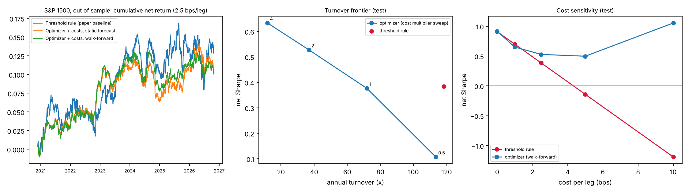

# Convex Portfolio Optimization for Statistical Arbitrage

**Replacing the s-score threshold rule with a cost-aware, risk-limited optimizer, tested on 12 years of S&P 1500 data**

Companion project to [*Screening for Mean Reversion in Statistical Arbitrage*](https://github.com/yamenfargaly-maker/statarb-screening).
That paper found that net Sharpe is mostly a story about **turnover**. This project keeps the same Avellaneda–Lee
signals and replaces only the portfolio construction step: a daily convex optimizer that prices transaction costs,
limits risk and turnover, and uses shrinkage covariance.

## Headline result (real data, out of sample)

S&P 1500 (current constituents), Yahoo Finance daily data. Trained Jul 2015 – Nov 2020 and **tested Nov 2020 – Oct 2026**.
All parameters were chosen on the training years only. Costs are 2.5 bps per leg (the paper's headline assumption).

| Strategy | Net Sharpe | Gross Sharpe | Turnover | Breakeven (bps/leg) | Max DD | Vol |
|---|---:|---:|---:|---:|---:|---:|
| Threshold rule (paper baseline) | 0.38 | 0.91 | 118× | 4.3 | −9% | 6% |
| Linear in alpha, no optimizer | 0.05 | 0.73 | 159× | 2.7 | −15% | 6% |
| Optimizer, **cost-unaware** | **−0.64** | 0.92 | 233× | 1.5 | −17% | 4% |
| **Optimizer + costs, walk-forward forecast** | **0.53** | 0.81 | **37×** | **7.1** | **−5%** | 3% |
|  + Ledoit–Wolf covariance | 0.53 | 0.81 | 13× | 7.2 | −1% | 1% |

**Cost sensitivity (test):**

| bps per leg | 0 | 1 | 2.5 | 5 | 10 |
|---|---:|---:|---:|---:|---:|
| Threshold rule | 0.91 | 0.70 | 0.38 | **−0.14** | −1.19 |
| Optimizer | 0.92 | 0.65 | 0.53 | **+0.50** | (1.05)* |

\*At 10 bps the optimizer trades only about 2× a year. That is essentially one static long-short bet, so its Sharpe is not evidence of anything.



### What the real data says

1. **The signal is real but small, and stable.** The rank IC of −s against 10-day residual returns is about 0.01–0.02 and
   positive in most years. Walk-forward refits every January estimate almost the same reversion slope from 2020 to 2026.
   On the S&P 500 alone the edge was mostly gone after 2020. Going to the S&P 1500 (about 1,330 names a day) is what keeps it alive.
2. **Pricing costs is the whole game.** The same optimizer *without* the cost term trades 233× a year and loses money
   (−0.64). With costs it trades 37× and earns 0.53. It cuts turnover 69% vs the threshold rule, raises breakeven cost from
   4.3 to 7.1 bps, and halves drawdown.
3. **The gain comes from trading *less*, not trading better.** At the threshold rule's own turnover (cost multiplier 0.5,
   about 113×) the optimizer is *worse* (0.11 vs 0.38). The threshold rule is a good high-turnover rule. The optimizer wins because it
   can move along the frontier to a slower, cheaper portfolio, and the advantage grows with costs: at 5 bps the
   threshold rule loses money and the optimizer doesn't.
4. **Diversification matters at this breadth.** With a 2% name cap and low risk aversion, the optimizer piled into about 150 names
   and lost to the threshold rule even in-sample. A 1% cap plus high risk aversion spreads it across about 1,400 names.
5. **Read the risk numbers carefully.** The optimizer runs at about 3% vol vs 6%, so its cumulative raw return is slightly *lower*
   than the threshold rule's (figure, left). Its edge is per unit of risk. Newey–West t-stats are about 1.3, so the
   improvement is suggestive, not statistically significant over six years.

**Biases to keep in mind:** the universe is *today's* S&P 1500 (survivorship bias, no delisted names), so absolute
Sharpe ratios are optimistic. Both strategies use the same universe, so the *comparison* between them is the meaningful part.

## The optimization problem

Each day, with alpha forecasts α, current weights w⁰, and covariance Σ = GᵀG + diag(d):

```
maximize   αᵀw − λ·H·(‖G w‖² + Σ dᵢ wᵢ²) − τ · Σ cᵢ |wᵢ − w⁰ᵢ| − u · Σ (σ_α,ᵢ wᵢ)²
subject to ‖w‖₁ ≤ 2,  |wᵢ| ≤ cap,  1ᵀw = 0,  [‖w − w⁰‖₁ ≤ turnover cap],  [wᵀΣw ≤ σ²_max]
```

This is a convex QP (an SOCP when the risk cap is on), compiled once with **cvxpy DPP** and re-solved daily (OSQP / Clarabel) in
about 170 ms for 1,500 names. Linear costs create a **no-trade region** around the current book: a name only trades when its
marginal alpha beats its marginal cost.

**Forecast.** Instead of the closed-form OU formula, `AlphaModel` learns E[10-day residual return | s] in σ_eq units from
binned training data. That captures the monotone reversion zone and the flattening/continuation beyond |s| ≈ 2.5 (breakouts),
and it puts alpha in units that can be compared against costs. `WalkForwardAlpha` re-fits it every January on all prior data,
with a gap so no forward returns leak in.

**Risk.** Sample, diagonal, Ledoit–Wolf (2004), or PCA with Marchenko–Pastur eigenvalue clipping, all expressed in
low-rank + diagonal form so the risk term stays cheap.

## Pipeline

```bash
pip install -r requirements.txt
python scripts/fetch_yahoo.py                                     # S&P 1500 OHLCV -> data/yahoo_sp1500.parquet
python scripts/build_signals_yahoo.py data/yahoo_sp1500.parquet \
       --out data/signals_sp1500.npz                              # PCA(15) residuals, 60-day OU s-scores (~70 s)
python scripts/run_real.py data/signals_sp1500.npz                # train/test study (~45 min on 2 cores)
python -m pytest tests/                                           # 18 tests
```

`build_signals_yahoo.py` follows the paper's construction: 15 eigenportfolios of the trailing 252-day correlation matrix
(solved through the 252×252 dual problem, so 1,500 names take seconds), a 60-day residual regression, an AR(1) fit of the
cumulative residual, and s = −(m − m̄)/σ_eq with no κ screen. The output uses the same `signals_*.npz` format as the paper's
pipeline, so `run_real.py` also runs on the original Sharadar signals.

## Synthetic validation

`statopt.simulate` builds a panel in the same format, with OU plus random-walk residuals and clustered shocks, calibrated so the
threshold rule reproduces the paper's Sharadar numbers (gross Sharpe ≈ 1.6, net ≈ 1.05 at 2.5 bps, ≈ 140× turnover). It is used to
check that the machinery behaves as intended (`scripts/run_experiments.py`, results in `results/`). On that panel the
optimizer improves net Sharpe from 0.94 to about 1.4–1.5, and shrinkage covariance beats the sample estimate. The real-data gains are
smaller, which is the expected direction.

## Repository

| Path | Contents |
|---|---|
| `statopt/alpha.py` | OU forecast, binned `AlphaModel`, `WalkForwardAlpha` |
| `statopt/risk.py` | sample / diagonal / Ledoit–Wolf / PCA-MP covariance |
| `statopt/optimizer.py` | DPP convex problem |
| `statopt/policies.py` | threshold rule, linear, optimizer policies |
| `statopt/backtest.py` | daily backtest, Sharpe, Newey–West t, breakeven |
| `scripts/` | data fetch, signal build, experiments, simulator calibration |
| `results_sp1500/` | real-data tables and figure |
| `results/` | synthetic-panel tables and figure |

## References

Avellaneda & Lee (2010); Ledoit & Wolf (2004); Gârleanu & Pedersen (2013), *Dynamic trading with predictable returns and
transaction costs*; Boyd et al. (2017), *Multi-period trading via convex optimization*; Grinold & Kahn, *Active Portfolio
Management*.
